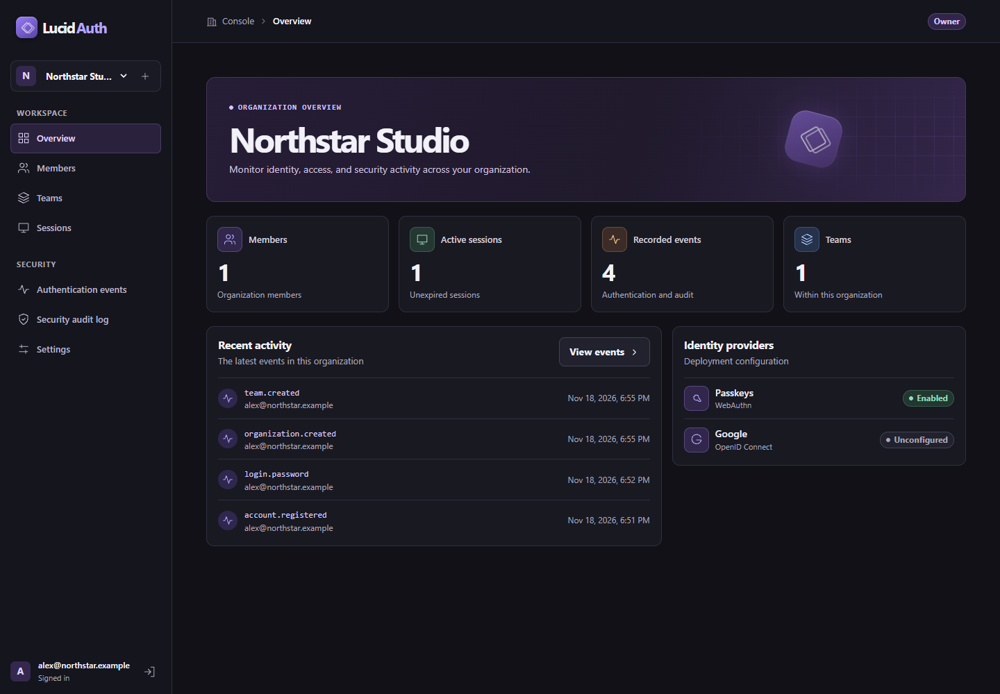
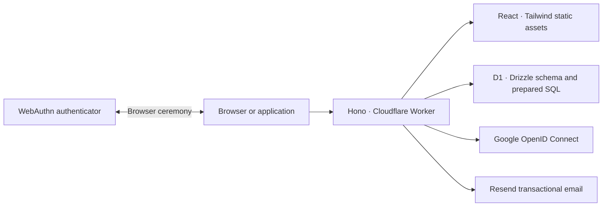
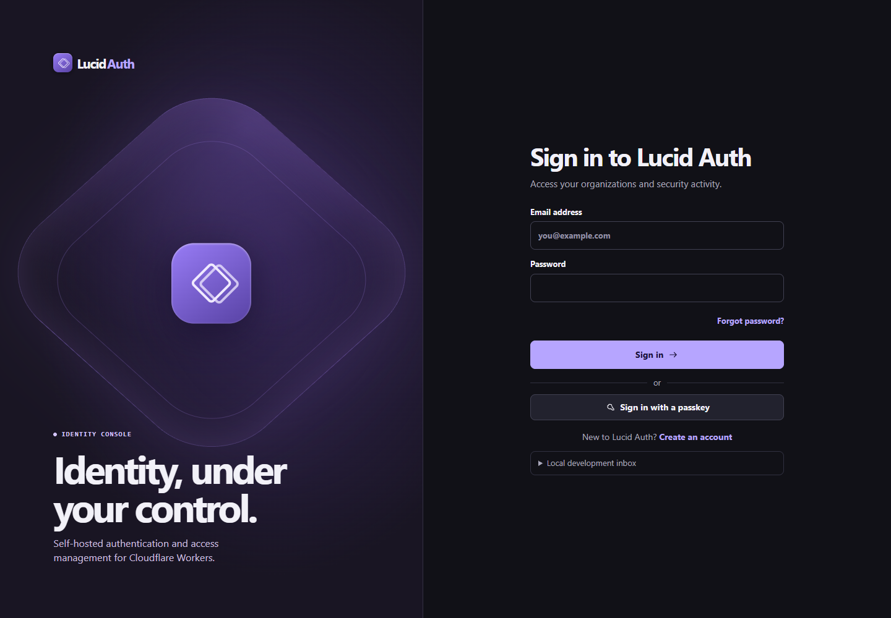

# Lucid Auth

Self-hostable authentication and authorization for Cloudflare Workers, with passkeys, OAuth, secure sessions, RBAC, and a developer dashboard.

Lucid Auth gives an application a first-party identity store, organization-scoped access controls, and an operator console. Deploy the API and console together on a canonical domain, with a D1 database in your Cloudflare account.



- Email verification and password recovery, Google OpenID Connect, and discoverable WebAuthn passkeys
- Revocable browser sessions with hashed secrets and atomic refresh rotation
- Organization memberships, team rosters, built-in roles, and permission checks
- Searchable member, session, and event views with audited permission changes
- Typed SDK source and a runnable Next.js App Router integration

## Architecture



The Worker serves console assets and the REST API from the same origin. Drizzle provides typed session lookups. Parameterized SQL expresses scoped queries and conditional writes, and D1 batches group authorization-sensitive writes with their audit events.

## Quick start

Use Node.js 24 LTS and pnpm 11.25.0. Install pnpm with `npm install -g pnpm@11.25.0` if needed. From this directory:

```sh
pnpm install --frozen-lockfile
pnpm db:migrate
pnpm dev
```

1. Open **http://localhost:8787** and create an account using a test address and a password of at least 15 characters.
2. Expand **Local development inbox**, load messages, and open the verification link in the registration browser.
3. Verify, sign in, and create an organization. Its creator becomes its owner.
4. Create a second verified test account in a separate browser session to exercise membership, roles, and teams.

The local inbox is bounded and in-memory. It resets on Worker restart or reload. Use **Forgot password** to activate or recover a pending account if you lose its verification link or change browsers. Use `localhost` for passkeys and keep the hostname consistent.

<details>
<summary>Sign-in screenshot</summary>



</details>

## Configuration

| Key                    | Where                   | Purpose                                                                           |
| ---------------------- | ----------------------- | --------------------------------------------------------------------------------- |
| `APP_ORIGIN`           | Wrangler `vars`         | Exact browser origin without a path or trailing slash. Production requires HTTPS. |
| `DEV_MAIL`             | Wrangler `vars`         | `1` enables the local inbox on loopback only. Remove for production.              |
| `MAIL_API_KEY`         | Worker secret           | Resend API key for verification and recovery.                                     |
| `MAIL_FROM`            | Worker secret or var    | Verified sender, e.g. `Lucid Auth <auth@example.com>`.                            |
| `GOOGLE_CLIENT_ID`     | Worker secret or var    | Google web OAuth client ID.                                                       |
| `GOOGLE_CLIENT_SECRET` | Worker secret           | Google OAuth client secret.                                                       |
| `DB`                   | Wrangler D1 binding     | Database for user, session, tenant, rate limit and event data.                    |
| `ASSETS`               | Wrangler assets binding | Vite output in `dist/`.                                                           |

For local provider development, copy `.dev.vars.example` to `.dev.vars` and fill the required values. The Google callback URL is exactly `${APP_ORIGIN}/api/auth/google/callback`. Configure this in Google Cloud as an authorized redirect URI. The WebAuthn relying party ID is the hostname in `APP_ORIGIN`. Changing it can make existing passkeys unusable.

## Deploy to Cloudflare

1. Authenticate Wrangler and create a D1 database.

   ```sh
   pnpm exec wrangler login
   pnpm exec wrangler d1 create lucid-auth
   ```

2. Edit `wrangler.jsonc`. Set the returned database ID, your HTTPS `APP_ORIGIN`, and a custom-domain route such as `"routes": [{"pattern": "auth.example.com", "custom_domain": true}]`. Remove the local inbox setting. Keep Worker-first assets routing and disable alternate preview hosts.
3. Verify your sending domain with Resend. Configure secrets interactively.

   ```sh
   pnpm exec wrangler secret put MAIL_API_KEY
   pnpm exec wrangler secret put MAIL_FROM
   # Optional Google sign-in
   pnpm exec wrangler secret put GOOGLE_CLIENT_ID
   pnpm exec wrangler secret put GOOGLE_CLIENT_SECRET
   ```

4. Apply migrations, deploy, and verify sign-up, recovery, refresh, logout, and each enabled provider on a staging domain.

   ```sh
   pnpm db:migrate:remote
   pnpm deploy
   ```

Use the Workers Paid plan for the native scrypt work factor and validate CPU budgets on the deployed Worker. Set Cloudflare edge limits for sensitive paths before inviting public traffic. Leave invocation URL logging disabled because the OAuth callback query includes a short-lived authorization code. Protect D1 and backups as sensitive identity data. The hourly cron prunes expired records and events older than 90 days.

## Integrate an application

Use a first-party origin or a trusted same-origin backend proxy. The Worker accepts JSON mutations only with an exact canonical `Origin`. A proxy must check its own browser origin before setting the upstream origin. Forward only the Lucid session cookies, preserve each response `Set-Cookie`, and disable caching. Browsers manage HttpOnly cookies automatically.

```ts
import { createLucidClient } from "./sdk";

const lucid = createLucidClient();
await lucid.register({ email: "user@example.com", password });
await lucid.verifyEmail(verificationToken);
await lucid.login({ email: "user@example.com", password });
const { user } = await lucid.session();
```

```ts
import { createLucidServer } from "./sdk";

const lucid = createLucidServer("https://auth.example.com");
const cookie = request.headers.get("cookie") ?? "";
const session = await lucid.verifySession(cookie);

if (!session) return new Response("Sign in required", { status: 401 });
if (!(await lucid.hasPermission(cookie, organizationId, "org:read"))) {
  return new Response("Access denied", { status: 403 });
}
```

The Hono Worker exports `requireSession` in `src/core.ts` and `requirePermission` in `src/organizations.ts`. Run session middleware first. Permission middleware expects an `:org` parameter. Filter each resource query by the authorized organization and reapply the permission predicate inside writes that must tolerate concurrent revocation.

See the [REST API reference](docs/api.md), [security notes](docs/security.md), and [Next.js integration](examples/nextjs/README.md).

## Development checks

```sh
pnpm check
pnpm audit --audit-level high
pnpm exec wrangler deploy --dry-run
```

The integration tests run inside Workerd against migrated D1. They cover password and recovery flows, session and refresh races, malicious and malformed requests, tenant isolation, role mutation and auditing, signed Google fixtures, and a synthetic WebAuthn authenticator.

## Known limits and roadmap

- Google account linking, external identity lifecycle (SCIM/SAML), TOTP and recovery codes, and delegated per-application OAuth are outside this release. A Google sign-in with an email that already exists locally requires the original sign-in method.
- This deployment is a first-party identity service. It does not issue portable JWTs for third-party apps. Organizations share identities, while application authorization is scoped to the selected organization.
- Organization managers add verified users directly by exact email. An invitation acceptance flow is future work. Teams group existing members and do not grant a separate layer of permissions.
- Account and team roster views cap lists at 100. Organization lists use offset pagination. Larger deployments should add cursor pagination and external audit export.
- Hosted Cloudflare, live Google and Resend, and physical authenticator behavior require staging verification with operator-owned accounts. There has been no independent security audit.

MIT licensed. See [LICENSE](LICENSE).
